# DocuVi — AI-Powered Layout-Preserving PDF Translation System (English to Vietnamese)

[](README.md)
[](README.en.md)
[](https://www.python.org/)
[](https://flask.palletsprojects.com/)
[](https://pymupdf.readthedocs.io/)
[](https://pytorch.org/)
[](https://huggingface.co/vinai/vinai-translate-en2vi)

**DocuVi** is an open-source, local-first Python application designed to translate English PDF documents into Vietnamese while strictly preserving page layout, typography styles, tables, and vector graphics/images. Powered by **PyMuPDF (`fitz`)** and VinAI's neural Seq2Seq translation model (`vinai/vinai-translate-en2vi`), DocuVi provides both a modern interactive Single-Page Application (SPA) Web UI and a headless Command-Line Interface (CLI).

---

## Table of Contents

- [Overview](#overview)
  - [The Real-World Problem](#the-real-world-problem)
  - [The DocuVi Solution](#the-docuvi-solution)
- [Key Features](#key-features)
- [UI & User Experience](#ui--user-experience)
- [System Architecture](#system-architecture)
  - [Processing Pipeline](#processing-pipeline)
  - [Core Modules](#core-modules)
- [Tech Stack](#tech-stack)
- [Project Structure](#project-structure)
- [Hardware & System Requirements](#hardware--system-requirements)
- [Installation & Setup](#installation--setup)
- [Usage Guide](#usage-guide)
  - [1. Web Interface (Recommended)](#1-web-interface-recommended)
  - [2. Command-Line Interface (CLI)](#2-command-line-interface-cli)
  - [3. Python API Integration](#3-python-api-integration)
- [Empirical Benchmarks](#empirical-benchmarks)
- [Technical Limitations](#technical-limitations)
- [Testing & Quality Assurance](#testing--quality-assurance)
- [Troubleshooting](#troubleshooting)
- [Roadmap](#roadmap)
- [License & Acknowledgments](#license--acknowledgments)

---

## Overview

### The Real-World Problem
Translating technical documents, scientific papers, textbooks, and business reports in PDF format typically suffers from severe formatting issues:
- **Layout Breakage:** Conventional tools extract plain text linearly, destroying multi-column alignments, headers, footers, lists, and margins.
- **Destruction of Graphics:** Vector charts, diagrams, and embedded photographs are often shifted or erased during document reconstruction.
- **Text Overflow:** Translated Vietnamese text is typically 15–30% longer than the original English text, causing paragraphs to overflow page margins or overlap adjacent content blocks.

### The DocuVi Solution
DocuVi resolves these challenges by operating directly on the spatial geometry tree of the PDF:
1. Parses geometric coordinates and bounding boxes of every text block, line, table cell, and character span.
2. Automatically detects and filters non-translatable tokens (mathematical formulas, page numbers, technical identifiers, URLs, citations) to preserve data integrity.
3. Performs length-sorted batch neural translation on GPU (CUDA FP16) or CPU.
4. Applies a **3-Stage Dynamic Font Fitting** engine backed by an in-memory layout simulator (`ScratchFontTester`) and bundled Unicode Times New Roman fonts to compute optimal font sizes and line spacing.
5. Uses selective redaction and textbox insertion while strictly protecting original raster images, vector line art, and non-rendered fallback text.

---

## Key Features

- **Neural Machine Translation (EN $\rightarrow$ VI):** Powered by VinAI's `vinai/vinai-translate-en2vi` Seq2Seq model running in FP16 half-precision on NVIDIA CUDA GPUs (with automatic fallback to CPU).
- **Two Flexible Decoding Modes:**
  - *Fast Mode (`num_beams=1`):* Greedy decoding for high-throughput document translation.
  - *Accurate Mode (`num_beams=4`):* Beam search decoding for enhanced fluency and academic precision.
- **Multi-Column Isolation & Table Preservation:**
  - Detects independent multi-column reading flows and parallel horizontal text clusters (`split_horizontal_lines`).
  - Isolates and preserves individual cells in both bordered tables (`find_tables`) and borderless data grids, preventing cross-column merging.
  - Preserves bulleted/numbered list markers (`list_marker`) and paragraphs with bold lead-in phrases (`_bold_ratio`).
- **Absolute Protection of Images & Vector Graphics:**
  - Applies PyMuPDF selective redaction masks (`PDF_REDACT_IMAGE_NONE`, `PDF_REDACT_LINE_ART_NONE`), guaranteeing 100% preservation of illustrations, charts, and vector lines.
  - Obstacle-aware bounding box expansion (`compute_safe_insert_rect`) prevents expanded text boxes from overlapping adjacent figures or text blocks.
- **Dynamic Font Fitting & Unicode Normalization:**
  - Bundled with 4 complete Unicode Times New Roman TrueType font variants (`times.ttf`, `timesbd.ttf`, `timesi.ttf`, `timesbi.ttf`).
  - Automatically scales font sizes (down to 4.5pt for paragraphs and 4.0pt for table cells) and line-height ratios (down to 0.98) via binary search.
- **Zero-Loss Fallback & Page Restore Safety:**
  - If a translation cannot fit safely within its obstacle-aware bounding box without clipping, DocuVi **automatically retains the original English text** to preserve visual integrity.
  - Automatically backs up each page (`page_backup`) prior to redaction and restores the untouched original page if any textbox insertion fails.
- **Modern Interactive Web SPA:**
  - Responsive UI built with Tailwind CSS and Phosphor Icons.
  - Side-by-side Dual PDF Viewer (Original vs. Translated) for instant visual comparison.
  - Asynchronous background job queue via `ThreadPoolExecutor` with real-time progress polling.
  - Built-in Dark / Light mode toggle and client-side translation history stored in `localStorage`.
- **Command-Line Interface (CLI):** Headless execution for batch automation scripts.

---

## UI & User Experience

The Web interface provides:
1. **Drag-and-Drop Upload Zone:** Intuitive PDF file dropzone with client-side format validation and a 50MB file size guard.
2. **Translation Mode Selector:** Seamless toggle between *Fast (`num_beams=1`)* and *Accurate (`num_beams=4`)*.
3. **Real-Time Progress Bar:** Live percentage and step-by-step status updates across layout extraction, AI batch inference, and PDF rendering.
4. **Synchronized Dual PDF Viewer:** Side-by-side embedded PDF frames comparing the original English document and the translated Vietnamese output.

---

## System Architecture

DocuVi is structured into two distinct layers:
1. **Application Layer ([`app.py`](file:///f:/project/app.py), [`templates/index.html`](file:///f:/project/templates/index.html)):** Handles HTTP requests, file upload validation, asynchronous worker dispatch, and the interactive Web UI.
2. **Core Processing Layer ([`pdf_engine/`](file:///f:/project/pdf_engine/__init__.py), [`pdf_process.py`](file:///f:/project/pdf_process.py)):** Encapsulates spatial layout extraction, text preprocessing, neural batch translation, dynamic font fitting, and PDF reconstruction.

### Processing Pipeline

```mermaid
flowchart TD
    A["Original English PDF"] --> B["1. Spatial Layout Extraction (PyMuPDF)"]
    B --> B1["Extract text blocks, spans, font styles & bounding boxes"]
    B --> B2["Detect multi-column flows, lists & bordered/borderless tables"]
    
    B1 --> C["2. Text Preprocessing & Filtering"]
    C --> C1["Reconstruct hyphenated line-break words"]
    C --> C2["Filter URLs, numbers, math formulas & citations"]
    C --> C3["Segment paragraphs into complete sentences"]
    
    C3 --> D["3. Neural Batch Translation"]
    D --> D1["Length-sorted sentence batching to minimize padding"]
    D --> D2["VinAI Seq2Seq Inference (CUDA FP16 / CPU Fallback)"]
    
    D2 --> E["4. Dynamic Font Fitting & Validation"]
    E --> E1["ScratchFontTester: In-memory RAM binary-search fitting"]
    E --> E2["Compute obstacle-aware safe insertion rectangles"]
    
    E2 --> F{"Fits safely without overflow?"}
    F -- "Yes" --> G["Selective Redaction & Vietnamese Text Insertion (TNR Font)"]
    F -- "No" --> H["Retain Original English Text (Zero-Loss Fallback)"]
    
    G --> I["5. Page Verification, Compression & Save"]
    H --> I
    I --> J["Translated Vietnamese PDF (outputs/)"]
```



### Core Modules

| Module | Location | Primary Responsibility |
| :--- | :--- | :--- |
| **[`app.py`](file:///f:/project/app.py)** | Root directory | Flask web server, REST API endpoints, upload security validation, async worker queue, and CLI runner. |
| **[`pdf_process.py`](file:///f:/project/pdf_process.py)** | Root directory | High-level pipeline orchestrator connecting layout extraction, batch translation, 3-stage font fitting, and page backup/restore. |
| **[`pdf_engine/config.py`](file:///f:/project/pdf_engine/config.py)** | `pdf_engine/` | Font path configuration, thread-safe lazy font buffer caching, system font fallbacks, and Bold/Italic style detection. |
| **[`pdf_engine/layout_extractor.py`](file:///f:/project/pdf_engine/layout_extractor.py)** | `pdf_engine/` | Modular layout parser (`extract_page_elements`, `_extract_bordered_table_elements`, `_extract_text_block_elements`, `_sort_and_normalize_elements`). |
| **[`pdf_engine/text_processor.py`](file:///f:/project/pdf_engine/text_processor.py)** | `pdf_engine/` | Unicode NFKC normalization, hyphenated word reconstruction, semantic token filtering, and abbreviation-aware sentence splitting. |
| **[`pdf_engine/renderer.py`](file:///f:/project/pdf_engine/renderer.py)** | `pdf_engine/` | `ScratchFontTester` (in-memory font fitting simulator), obstacle collection, selective redaction rect builder, and `compute_safe_insert_rect`. |
| **[`pdf_engine/translator.py`](file:///f:/project/pdf_engine/translator.py)** | `pdf_engine/` | Thread-safe singleton model loader, length-sorted batching, long-sentence chunking, and automatic CUDA OOM recovery. |

---

## Tech Stack

- **Language:** Python 3.10+
- **PDF & 2D Graphics Processing:**
  - `PyMuPDF (fitz)` (>= 1.24.0): High-performance C/C++ library for spatial text extraction, table detection, redaction, font embedding, and page rendering.
- **Deep Learning & Natural Language Processing:**
  - `PyTorch (torch)` (>= 2.0.0): Tensor computation, FP16 half-precision GPU execution, and CUDA memory management.
  - `Hugging Face Transformers` (>= 4.40.0): Seq2Seq model loading and Greedy / Beam Search decoding.
  - `SentencePiece` & `Protobuf`: Subword tokenization for the VinAI translation model.
  - `vinai/vinai-translate-en2vi`: Pre-trained neural machine translation model specialized for English-to-Vietnamese.
- **Backend Platform:**
  - `Flask` (>= 3.0.0) & `Werkzeug`: RESTful API routing, static file serving, and secure file upload handling.
  - `concurrent.futures.ThreadPoolExecutor`: Background task execution without blocking the HTTP server.
- **Frontend Platform:**
  - HTML5 & Modern Vanilla JavaScript (ES6+).
  - `Tailwind CSS` (via CDN) & `Phosphor Icons` (via CDN).
  - Browser `localStorage` for persistent client-side translation history.

---

## Project Structure

```text
DocuVi/
├── Font/                           # Bundled Unicode Times New Roman TrueType fonts
│   ├── times.ttf                   # Regular
│   ├── timesbd.ttf                 # Bold
│   ├── timesbi.ttf                 # Bold-Italic
│   └── timesi.ttf                  # Italic
├── pdf_engine/                     # Core PDF & NLP processing package
│   ├── __init__.py                 # Package initialization & public API exports
│   ├── config.py                   # Font configuration & lazy buffer management
│   ├── layout_extractor.py         # Spatial layout parser, multi-column & table handler
│   ├── renderer.py                 # In-memory font tester & obstacle-aware rect calculator
│   ├── text_processor.py           # Text normalization, de-hyphenation & sentence splitter
│   └── translator.py               # VinAI model singleton & GPU/CPU batch inference
├── templates/
│   └── index.html                  # Interactive Single-Page Application (SPA) Web UI
├── uploads/                        # Temporary uploaded PDF storage
├── outputs/                        # Translated PDF output storage
├── app.py                          # Main entry point: Flask Web Server & CLI Runner
├── pdf_process.py                  # End-to-end PDF translation pipeline orchestrator
├── requirements.txt                # Python package dependencies
├── test_suite.py                   # Comprehensive 19-case automated regression test suite
├── .gitignore                      # Git exclusion rules
├── PROJECT_SUMMARY.md              # In-depth technical documentation (Vietnamese)
├── README.md                       # Vietnamese documentation (Default)
└── README.en.md                    # English documentation (This file)
```

---

## Hardware & System Requirements

### Recommended Configuration (GPU Mode)
- **GPU:** NVIDIA CUDA-capable GPU with $\ge$ 4 GB VRAM (e.g., GTX 1650, RTX 3050, RTX 3060 or higher).
- **RAM:** $\ge$ 8 GB system memory.
- **Disk Space:** $\ge$ 3 GB free space (for PyTorch packages and cached Hugging Face model weights).

### Minimum Configuration (CPU Mode)
- **CPU:** 64-bit multi-core processor (Intel Core i5/i7 or AMD Ryzen).
- **RAM:** $\ge$ 8 GB system memory.
- *Note:* DocuVi automatically detects available hardware. If no CUDA GPU is found, it seamlessly falls back to CPU execution with full layout-preservation functionality.

---

## Installation & Setup

### 1. Clone the repository
```bash
git clone https://github.com/tranhuy126/DocuVi.git
cd DocuVi
```

### 2. Create and activate a virtual environment

**On Windows (PowerShell):**
```powershell
python -m venv .venv
.\.venv\Scripts\Activate.ps1
```

**On Linux / macOS:**
```bash
python3 -m venv .venv
source .venv/bin/activate
```

### 3. Install dependencies
```bash
pip install --upgrade pip
pip install -r requirements.txt
```

> [!TIP]
> **Enable NVIDIA GPU Hardware Acceleration:**  
> To maximize translation speed on Windows or Linux with an NVIDIA GPU, install the CUDA-enabled PyTorch build matching your driver (e.g., CUDA 12.1):
> ```bash
> pip install torch --index-url https://download.pytorch.org/whl/cu121
> ```

### 4. Automatic Model Weight Download
No manual model download is required. On first run, DocuVi automatically downloads `vinai/vinai-translate-en2vi` (~1.2 GB) from Hugging Face Hub into your local cache (`~/.cache/huggingface/hub/`).

---

## Usage Guide

### 1. Web Interface (Recommended)

Start the Flask server:
```bash
python app.py
```

Once the model is preloaded and the server starts, open your browser at:
```text
http://127.0.0.1:5000
```

Steps on the Web UI:
1. **Upload PDF:** Drag and drop an English `.pdf` file into the upload zone or click to browse.
2. **Select Translation Mode:**
   - **Fast (`num_beams=1`):** Greedy decoding, ideal for long documents or quick reading.
   - **Accurate (`num_beams=4`):** Beam search decoding, recommended for academic papers and formal reports.
3. **Translate:** Click **"Bắt đầu dịch ngay"** (Start Translation).
4. **Compare & Download:** Inspect the original and translated PDFs side-by-side in the browser or download the translated file.

---

### 2. Command-Line Interface (CLI)

DocuVi supports direct headless execution from the terminal:

```bash
python app.py path/to/document.pdf
```

Example with the sample document:
```bash
python app.py uploads/test1.pdf
```

The translated PDF is automatically saved to `outputs/translated_<original_filename>.pdf`.

---

### 3. Python API Integration

You can also invoke DocuVi directly from your own Python scripts:

```python
from pdf_process import translate_pdf

translate_pdf(
    input_path="sample_document.pdf",
    output_path="translated_document.pdf",
    batch_size=32,
    num_beams=4,
)
```

---

## Empirical Benchmarks

Performance metrics measured on a real-world complex medical paper:
- **Test Hardware:** 12th Gen Intel Core, 12 GB RAM, NVIDIA GeForce RTX 3050 Laptop GPU (6 GB VRAM, CUDA FP16), Windows 11.
- **Test Dataset:** `uploads/test1.pdf` (Medical research article on ADHD, **9 pages**, **302 extracted sentences**, two-column layout with embedded tables).

| Metric | Fast Mode (`num_beams=1`) | Accurate Mode (`num_beams=4`) | Technical Context |
| :--- | :---: | :---: | :--- |
| **Initial Model Load Time** | ~8.14 s | ~8.14 s | Loaded once into VRAM via thread-safe Lazy Singleton |
| **Total End-to-End Processing Time** | **5.62 s** | **~28.5 s** | Full pipeline (layout extraction, GPU batch inference, PDF rendering) |
| **Average Time per Page** | **~0.62 s / page** | **~3.16 s / page** | 9-page complex two-column academic layout |
| **Average Inference Time per Sentence** | **~0.019 s / sent** | **~0.094 s / sent** | Length-sorted dynamic tensor batching (`batch_size=32`) |

---

## Technical Limitations

1. **Scanned / Image-Only PDFs:** DocuVi operates on vector text layers. Scanned PDFs without an embedded OCR text layer are safely rejected with a clear user-facing message.
2. **Vietnamese Text Expansion:** Vietnamese translations are typically 15–30% longer than English. In ultra-tight bounding boxes with no room to expand, DocuVi scales the font down to a safe legibility threshold (4.5pt for body text, 4.0pt for table cells). If the text still cannot fit without clipping, DocuVi **retains the original English text** (Zero-Loss Fallback).
3. **Single-Worker GPU Queue:** The Flask server defaults to `max_workers=1` to prevent VRAM contention on consumer GPUs.

---

## Testing & Quality Assurance

DocuVi includes an automated regression test suite in [`test_suite.py`](file:///f:/project/test_suite.py) covering **19 comprehensive test cases** (executing in **~2.69 seconds**):

```bash
python test_suite.py
```

### Verified 19 Regression Test Cases:
1. `test_case_1_short_valid_pdf`: End-to-end translation of a valid single-page PDF.
2. `test_case_2_multipage_multipara_pdf`: Multi-page, multi-paragraph document preservation.
3. `test_case_3_heading_body_bold_italic`: Typography hierarchy (Heading vs. Body, Bold, Italic) preservation.
4. `test_case_4_two_columns_layout`: Multi-column spatial isolation preventing cross-column overflow.
5. `test_case_5_overflow_long_paragraph`: Dynamic font size reduction via `ScratchFontTester` for expanded Vietnamese text.
6. `test_case_6_image_only_or_scanned_pdf`: Safe detection and rejection of image-only/scanned PDFs without text layers.
7. `test_case_7_corrupt_or_non_pdf_upload`: Magic-byte (`%PDF-`) and file extension validation against corrupt or spoofed uploads.
8. `test_case_8_model_empty_or_error_fallback`: Automatic retention of original English sentence when model output is empty.
9. `test_case_9_text_does_not_fit_preserves_original`: Zero-Loss Fallback preventing redaction when translated text cannot fit safely.
10. `test_case_10_missing_font_fallback`: Font buffer loading and fallback verification across all 4 style variants.
11. `test_case_11_job_failure_reporting`: Server path sanitization in error responses to prevent internal path disclosure.
12. `test_case_12_output_reopen_and_content_verification`: Output PDF integrity and UTF-8 Vietnamese diacritic verification.
13. `test_case_13_tab_space_formatting_and_short_titles`: Whitespace normalization, short title retention, and decorative leader filtering.
14. `test_case_14_borderless_table_row_preservation`: Detection and cell isolation for borderless multi-column tables.
15. `test_case_15_tiny_bbox_retention_regression`: Original text retention inside ultra-small bounding boxes without blocking adjacent blocks.
16. `test_case_16_insertion_failure_restores_original_page`: Full page restoration from `page_backup` if `insert_textbox` fails.
17. `test_case_17_list_items_split_and_marker_kept`: Bullet list (`•`) item separation and list marker preservation.
18. `test_case_18_bare_number_list_split`: Standalone numbered list (`1`, `2`, `3` $\rightarrow$ `1.`, `2.`, `3.`) merging and normalization.
19. `test_case_19_bold_lead_in_stays_in_paragraph`: Paragraphs starting with bold lead-in phrases (`_bold_ratio`) remain intact without premature splitting.

---

## Troubleshooting

1. **CUDA Out of Memory (`torch.cuda.OutOfMemoryError`):**
   - DocuVi automatically clears CUDA cache, halves the `batch_size`, and falls back to CPU for oversized sentences. You can also close other GPU-heavy applications or reduce `batch_size` in [`pdf_process.py`](file:///f:/project/pdf_process.py).
2. **Slow Translation Speed on CPU:**
   - Check `/api/system-status` or the top-right status badge on the Web UI. If it shows `CPU`, install the CUDA-enabled PyTorch wheel from [pytorch.org](https://pytorch.org).
3. **HTTP 413 Payload Too Large:**
   - Maximum upload size is 50MB by default (`MAX_CONTENT_LENGTH` in [`app.py`](file:///f:/project/app.py#L19)). Compress or split larger PDF files before uploading.

---

## Roadmap

- [ ] **OCR Engine Integration:** Integrate PaddleOCR or Tesseract to support scanned/image-only PDFs.
- [ ] **Bidirectional Translation:** Add Vietnamese-to-English (`vi2en`) translation support.
- [ ] **Bilingual Side-by-Side PDF Export:** Export merged bilingual pages or interleaved paragraphs.
- [ ] **Word (`.docx`) Export:** Allow exporting translated documents to editable Word format.
- [ ] **Docker Packaging:** Provide `Dockerfile` and `docker-compose.yml` for one-command deployment.

---

## License & Acknowledgments

### License
Developed for academic research and educational purposes. All rights reserved by the project authors.

### Acknowledgments
- **[VinAI Research](https://www.vinai.io/):** For pre-training and open-sourcing the `vinai-translate-en2vi` neural translation model.
- **[Artifex Software](https://pymupdf.readthedocs.io/):** For developing the high-performance PyMuPDF library.
- **[Hugging Face](https://huggingface.co/):** For the Transformers library and model hosting infrastructure.

