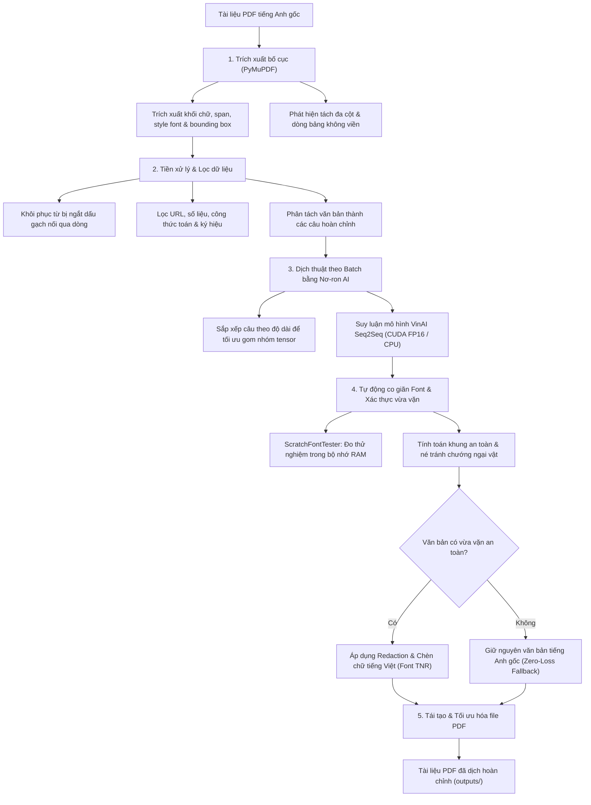

# DocuVi — Hệ Thống Dịch Thuật Tài Liệu PDF Giữ Nguyên Bố Cục Bằng AI (Tiếng Anh sang Tiếng Việt)

[](https://www.python.org/)
[](https://flask.palletsprojects.com/)
[](https://pymupdf.readthedocs.io/)
[](https://pytorch.org/)
[](https://huggingface.co/vinai/vinai-translate-en2vi)

DocuVi là một ứng dụng Python mã nguồn mở, hoạt động cục bộ (local-first) được thiết kế nhằm dịch thuật các tài liệu PDF tiếng Anh sang tiếng Việt trong khi vẫn bảo toàn tuyệt đối bố cục trang, phong cách typography, bảng biểu và các thành phần đồ họa vector/hình ảnh. Được vận hành bởi PyMuPDF và mô hình dịch thuật Seq2Seq của VinAI (`vinai/vinai-translate-en2vi`), DocuVi cung cấp cả giao diện Web tương tác hiện đại dạng Single-Page Application (SPA) lẫn giao diện dòng lệnh (CLI).

---

## Mục lục

- [Tổng quan](#tổng-quan)
  - [Vấn đề thực tế](#vấn-đề-thực-tế)
  - [Giải pháp của DocuVi](#giải-pháp-của-docuvi)
- [Tính năng nổi bật](#tính-năng-nổi-bật)
- [Giao diện & Trải nghiệm người dùng](#giao-diện--trải-nghiệm-người-dùng)
- [Kiến trúc hệ thống](#kiến-trúc-hệ-thống)
  - [Quy trình xử lý (Pipeline)](#quy-trình-xử-lý-pipeline)
  - [Các module cốt lõi](#các-module-cốt-lõi)
- [Công nghệ sử dụng](#công-nghệ-sử-dụng)
- [Cấu trúc dự án](#cấu-trúc-dự-án)
- [Yêu cầu phần cứng & hệ thống](#yêu-cầu-phần-cứng--hệ-thống)
- [Cài đặt & Thiết lập](#cài-đặt--thiết-lập)
- [Hướng dẫn sử dụng](#hướng-dẫn-sử-dụng)
  - [1. Giao diện Web (Khuyến nghị)](#1-giao-diện-web-khuyến-nghị)
  - [2. Giao diện Dòng lệnh (CLI)](#2-giao-diện-dòng-lệnh-cli)
  - [3. Tích hợp Python API](#3-tích-hợp-python-api)
- [Đo kiểm hiệu năng thực nghiệm](#đo-kiểm-hiệu-năng-thực-nghiệm)
- [Giới hạn kỹ thuật](#giới-hạn-kỹ-thuật)
- [Kiểm thử & Đảm bảo chất lượng](#kiểm-thử--đảm-bảo-chất-lượng)
- [Xử lý sự cố thường gặp](#xử-lý-sự-cố-thường-gặp)
- [Kế hoạch phát triển (Roadmap)](#kế-hoạch-phát-triển-roadmap)
- [Bản quyền & Lời cảm ơn](#bản-quyền--lời-cảm-ơn)

---

## Tổng quan

### Vấn đề thực tế
Dịch thuật các tài liệu kỹ thuật, báo cáo khoa học, sách giáo trình và tài liệu kinh doanh định dạng PDF thường gặp phải những thách thức nghiêm trọng về định dạng:
- **Vỡ bố cục trang (Layout Breakage):** Các công cụ thông thường chỉ trích xuất văn bản dưới dạng chuỗi thô, làm mất hoàn toàn căn lề đa cột, tiêu đề, chân trang và khoảng cách lề.
- **Mất mát hình ảnh và đồ họa (Destruction of Graphics):** Các biểu đồ vector, sơ đồ và ảnh chụp thường bị dịch chuyển sai lệch hoặc bị xóa mất trong quá trình tái tạo tài liệu.
- **Tràn viền văn bản (Text Overflow):** Câu tiếng Việt sau khi dịch thường dài hơn 15–30% so với câu tiếng Anh gốc, khiến văn bản tràn ra ngoài lề trang hoặc đè lên các khối nội dung xung quanh.

### Giải pháp của DocuVi
DocuVi giải quyết triệt để các vấn đề trên bằng cách can thiệp trực tiếp vào cây bố cục không gian của PDF:
1. Phân tích tọa độ hình học và bounding box của từng khối văn bản, dòng và span ký tự.
2. Tự động nhận diện và lọc các token không cần dịch (công thức toán, số trang, mã hiệu kỹ thuật, URL) để bảo toàn tính toàn vẹn dữ liệu.
3. Thực hiện dịch hàng loạt (batching) sắp xếp theo độ dài câu trên GPU hoặc CPU.
4. Ứng dụng động cơ **Dynamic Font Fitting** kết hợp bộ giả lập đo kích thước trong bộ nhớ RAM (`ScratchFontTester`) cùng bộ phông chữ Unicode Times New Roman chuẩn để tự động tính toán cỡ chữ và khoảng cách dòng tối ưu.
5. Áp dụng kỹ thuật che phủ (redaction) và chèn văn bản mục tiêu trong khi bảo vệ nghiêm ngặt các đối tượng hình ảnh và nét vẽ vector nguyên bản.

---

## Tính năng nổi bật

- **Dịch máy nơ-ron (EN $\rightarrow$ VI):** Sử dụng mô hình Seq2Seq chuyên biệt `vinai/vinai-translate-en2vi` từ VinAI với định dạng bán chính xác FP16 trên GPU NVIDIA CUDA (kèm cơ chế tự động chuyển đổi sang CPU khi cần).
- **Hai chế độ sinh văn bản linh hoạt:**
  - *Siêu tốc (`num_beams=1`):* Thuật toán giải mã Greedy cho tốc độ xử lý nhanh và thông lượng tài liệu cao.
  - *Chuẩn xác (`num_beams=4`):* Thuật toán Beam Search tăng cường độ mượt mà và tính học thuật của câu dịch.
- **Phân tách đa cột & Bảo toàn bảng số liệu:**
  - Nhận diện luồng đọc đa cột độc lập và các khối nội dung nằm ngang song song (`split_horizontal_lines`).
  - Phân tách và bảo vệ từng ô của bảng biểu không viền, ngăn chặn tình trạng gộp sai lệch dữ liệu giữa các cột.
- **Bảo vệ tuyệt đối hình ảnh & Đồ họa:**
  - Sử dụng mặt nạ che phủ PyMuPDF (`PDF_REDACT_IMAGE_NONE`, `PDF_REDACT_LINE_ART_NONE`), đảm bảo hình minh họa, biểu đồ và đường kẻ vector được giữ nguyên 100%.
  - Thuật toán né tránh chướng ngại vật ngăn chặn hộp chữ mở rộng đè lên các hình vẽ kế cận.
- **Tự động co giãn Font (Dynamic Font Fitting) & Chuẩn hóa Unicode:**
  - Tích hợp sẵn bộ 4 phông chữ Times New Roman Unicode hoàn chỉnh (`times.ttf`, `timesbd.ttf`, `timesi.ttf`, `timesbi.ttf`).
  - Tự động co giãn kích cỡ chữ (hỗ trợ hạ đến 4.5pt cho đoạn văn và 4.0pt cho ô bảng) cùng tỷ lệ giãn dòng linh hoạt (hạ đến 0.98).
- **Cơ chế an toàn Zero-Loss Fallback:**
  - Nếu bản dịch không thể vừa vặn trong khung an toàn mà không bị cắt chữ, DocuVi **tự động giữ lại văn bản gốc tiếng Anh** để tránh phá vỡ giao diện tài liệu.
  - Tự động fallback về câu gốc nếu mô hình dịch trả về chuỗi rỗng.
- **Giao diện Web SPA tương tác hiện đại:**
  - Thiết kế responsive hiện đại với Tailwind CSS và hệ thống biểu tượng Phosphor Icons.
  - Khung xem PDF song song (Original vs Translated) hỗ trợ so sánh trực quan.
  - Hàng đợi tác vụ ngầm bất đồng bộ bằng `ThreadPoolExecutor` kèm polling tiến trình theo thời gian thực.
  - Hỗ trợ chuyển đổi giao diện Sáng / Tối (Dark / Light mode).
  - Ngăn kéo lịch sử dịch thuật lưu trữ trực tiếp phía trình duyệt qua `localStorage`.
- **Giao diện dòng lệnh (CLI):** Hỗ trợ chạy không cần giao diện đồ họa, thuận tiện cho việc viết script tự động hóa hàng loạt.

---

## Giao diện & Trải nghiệm người dùng

Giao diện Web cung cấp:
1. **Khu vực kéo thả file (Dropzone):** Hỗ trợ kéo thả file PDF trực quan, tích hợp kiểm tra định dạng và giới hạn dung lượng 50MB ngay phía client.
2. **Bộ chuyển đổi chế độ dịch:** Lựa chọn linh hoạt giữa *Siêu tốc (Greedy)* và *Chuẩn xác (Beam Search)*.
3. **Thanh tiến trình trực quan:** Hiển thị phần trăm và trạng thái từng bước: phân tích trang, nạp mô hình, dịch thuật hàng loạt và kết xuất PDF.
4. **Trình xem PDF đối chiếu kép:** Hai khung hiển thị song song cho phép đối chiếu trang gốc và trang kết quả trực tiếp trên trình duyệt.

---

## Kiến trúc hệ thống

Hệ thống DocuVi được tổ chức thành hai tầng rõ ràng:
1. **Tầng ứng dụng (`app.py`, `templates/index.html`):** Tiếp nhận yêu cầu HTTP, xử lý tải file, điều phối tác vụ ngầm và hiển thị giao diện người dùng.
2. **Tầng lõi xử lý (`pdf_engine/`, `pdf_process.py`):** Đóng gói quy trình phân tích bố cục, xử lý văn bản, dịch máy nơ-ron, co giãn phông chữ và tái cấu trúc đồ họa PDF.

### Quy trình xử lý (Pipeline)



### Các module cốt lõi

| Module | Vị trí | Nhiệm vụ chính |
| :--- | :--- | :--- |
| **`app.py`** | Thư mục gốc | Khởi chạy máy chủ Flask, định nghĩa REST API, tiếp nhận upload, điều phối worker bất đồng bộ và CLI runner. |
| **`pdf_process.py`** | Thư mục gốc | Bộ điều phối cấp cao kết nối phân tích bố cục, dịch thuật, co giãn font và ghi file PDF đầu ra. |
| **`pdf_engine/config.py`** | `pdf_engine/` | Định nghĩa đường dẫn, cấu hình nạp phông chữ lazy-loading và nhận diện style font (Bold, Italic). |
| **`pdf_engine/layout_extractor.py`** | `pdf_engine/` | Phân tích cấu trúc block/span, phát hiện tách cột song song, gom cụm bảng biểu và sắp xếp thứ tự đọc tự nhiên. |
| **`pdf_engine/text_processor.py`** | `pdf_engine/` | Chuẩn hóa Unicode NFKC, khôi phục từ gãy dấu gạch nối qua dòng, lọc ký hiệu kỹ thuật và tách câu thông minh. |
| **`pdf_engine/renderer.py`** | `pdf_engine/` | `ScratchFontTester` (mô phỏng đo kích thước chữ trong RAM) và `compute_safe_insert_rect` (nới rộng khung an toàn tránh vật cản). |
| **`pdf_engine/translator.py`** | `pdf_engine/` | Khởi tạo mô hình dịch Singleton an toàn đa luồng, gom nhóm batch theo độ dài, quản lý VRAM và chống lỗi OOM. |

---

## Công nghệ sử dụng

- **Ngôn ngữ:** Python 3.10+
- **Xử lý PDF & Đồ họa:**
  - `PyMuPDF (fitz)` (>= 1.24.0): Thư viện C hiệu năng cao xử lý bóc tách văn bản, tính toán hình học, che phủ redaction, nhúng font và render trang.
- **Deep Learning & Xử lý ngôn ngữ tự nhiên:**
  - `PyTorch (torch)` (>= 2.0.0): Tính toán tensor, thực thi bán chính xác FP16 trên GPU và quản trị bộ nhớ CUDA.
  - `Hugging Face Transformers` (>= 4.40.0): Nạp mô hình, cấu hình Seq2Seq generation và giải mã Beam Search.
  - `SentencePiece` & `Protobuf`: Tokenizer phân tách từ phụ (subword) cho mô hình VinAI.
  - `vinai/vinai-translate-en2vi`: Mô hình dịch thuật Seq2Seq được huấn luyện tối ưu cho cặp ngôn ngữ Anh - Việt.
- **Nền tảng Backend:**
  - `Flask` (>= 3.0.0) & `Werkzeug`: Định tuyến RESTful API, phục vụ tài nguyên tĩnh và kiểm soát upload an toàn.
  - `concurrent.futures.ThreadPoolExecutor`: Hàng đợi xử lý tác vụ nền giúp máy chủ luôn phản hồi nhanh chóng.
- **Nền tảng Frontend:**
  - HTML5 & JavaScript hiện đại (ES6+).
  - `Tailwind CSS` (qua CDN): Framework giao diện utility-first hỗ trợ giao diện sáng/tối.
  - `Phosphor Icons` (qua CDN): Hệ thống icon tinh tế, đồng bộ.
  - Trình duyệt `localStorage`: Lưu trữ lịch sử dịch thuật bền vững tại máy người dùng mà không cần cơ sở dữ liệu cồng kềnh.

---

## Cấu trúc dự án

```text
DocuVi/
├── Font/                           # Thư mục phông chữ Times New Roman nhúng chuẩn Unicode
│   ├── times.ttf                   # Phông chữ thường (Regular)
│   ├── timesbd.ttf                 # Phông chữ đậm (Bold)
│   ├── timesbi.ttf                 # Phông chữ đậm - nghiêng (Bold-Italic)
│   └── timesi.ttf                  # Phông chữ nghiêng (Italic)
├── pdf_engine/                     # Gói xử lý PDF và NLP cốt lõi
│   ├── __init__.py                 # Khởi tạo package và xuất các hàm giao diện công khai
│   ├── config.py                   # Cấu hình phông chữ & quản lý nạp bộ đệm font
│   ├── layout_extractor.py         # Phân tích bố cục, phát hiện đa cột, xử lý bảng biểu
│   ├── renderer.py                 # Bộ đo font ảo trong RAM & tính toán khung chèn an toàn
│   ├── text_processor.py           # Chuẩn hóa văn bản, ghép từ gãy dòng, tách câu thông minh
│   └── translator.py               # Quản lý nạp mô hình VinAI & suy luận batch trên GPU/CPU
├── templates/
│   └── index.html                  # Giao diện Web SPA tương tác hoàn chỉnh
├── uploads/                        # Thư mục chứa file tải lên tạm thời
├── outputs/                        # Thư mục lưu trữ tài liệu PDF kết quả
├── app.py                          # Điểm khởi chạy chính: Flask Web Server & CLI Runner
├── pdf_process.py                  # Pipeline điều phối dịch thuật PDF toàn diện
├── requirements.txt                # Danh sách các gói phụ thuộc Python
├── test_suite.py                   # Bộ kiểm thử tự động toàn diện 15 trường hợp
├── .gitignore                      # Quy tắc loại trừ file của Git
└── README.md                       # Tài liệu hướng dẫn sử dụng dự án
```

---

## Yêu cầu phần cứng & hệ thống

### Cấu hình khuyến nghị (Chế độ GPU)
- **GPU:** Card đồ họa NVIDIA hỗ trợ CUDA, bộ nhớ $\ge$ 4 GB VRAM (ví dụ: GTX 1650, RTX 3050, RTX 3060 trở lên).
- **RAM:** $\ge$ 8 GB bộ nhớ hệ thống.
- **Ổ cứng:** $\ge$ 3 GB dung lượng trống (để chứa thư viện PyTorch và trọng số mô hình Hugging Face được tải về).

### Cấu hình tối thiểu (Chế độ CPU)
- **CPU:** Bộ vi xử lý đa nhân 64-bit (Intel Core i5/i7 hoặc AMD Ryzen).
- **RAM:** $\ge$ 8 GB bộ nhớ hệ thống.
- *Lưu ý:* DocuVi tự động nhận diện phần cứng. Nếu không tìm thấy GPU tương thích CUDA, hệ thống sẽ tự động chuyển sang chạy trên CPU (chức năng được bảo toàn trọn vẹn, tuy nhiên tốc độ dịch sẽ chậm hơn so với GPU).

### Yêu cầu phần mềm
- **Hệ điều hành:** Windows 10/11 (64-bit), Ubuntu 20.04+ / Debian, hoặc macOS.
- **Python:** Phiên bản Python 3.10, 3.11 hoặc 3.12.

---

## Cài đặt & Thiết lập

### 1. Tải mã nguồn dự án
```bash
git clone https://github.com/<your-username>/DocuVi.git
cd DocuVi
```

### 2. Khởi tạo và kích hoạt môi trường ảo

**Trên Windows (PowerShell):**
```powershell
python -m venv .venv
.\.venv\Scripts\Activate.ps1
```

**Trên Linux / macOS:**
```bash
python3 -m venv .venv
source .venv/bin/activate
```

### 3. Cài đặt các gói phụ thuộc
```bash
pip install --upgrade pip
pip install -r requirements.txt
```

> [!TIP]
> **Kích hoạt tăng tốc phần cứng bằng GPU NVIDIA:**  
> Để khai thác tối đa sức mạnh GPU trên Windows hoặc Linux, hãy cài đặt phiên bản PyTorch hỗ trợ CUDA phù hợp với driver máy tính. Ví dụ với CUDA 12.1:
> ```bash
> pip install torch --index-url https://download.pytorch.org/whl/cu121
> ```

### 4. Tải trước trọng số mô hình AI
Người dùng không cần thực hiện tải mô hình thủ công. Trong lần chạy dịch thuật đầu tiên, DocuVi sẽ tự động kết nối và tải mô hình `vinai/vinai-translate-en2vi` (~1.2 GB) từ Hugging Face Hub về thư mục bộ nhớ đệm cục bộ (`~/.cache/huggingface/hub/`).

---

## Hướng dẫn sử dụng

### 1. Giao diện Web (Khuyến nghị)

Khởi động máy chủ Flask:
```bash
python app.py
```

Sau khi máy chủ khởi động thành công, mở trình duyệt web và truy cập địa chỉ:
```
http://127.0.0.1:5000
```

Các bước thao tác trên Web:
1. **Tải file:** Kéo thả file `.pdf` tiếng Anh vào vùng tải lên hoặc bấm vào để chọn file từ máy tính.
2. **Chọn chế độ dịch:**
   - **Siêu tốc:** Sử dụng giải mã tham lam (`num_beams=1`), tối ưu cho tài liệu dài hoặc cần xem nhanh nội dung.
   - **Chuẩn xác:** Sử dụng tìm kiếm chùm (`num_beams=4`), phù hợp với các tài liệu khoa học đòi hỏi độ chuẩn xác cao.
3. **Tiến hành dịch:** Nhấn nút **"Bắt đầu dịch ngay"**.
4. **Xem kết quả & Tải về:** Khi hoàn tất, xem và đối chiếu tài liệu trực tiếp trên hai khung song song hoặc tải file PDF kết quả về máy.

---

### 2. Giao diện Dòng lệnh (CLI)

DocuVi hỗ trợ chạy trực tiếp từ terminal cho các luồng xử lý tự động:

```bash
python app.py path/to/document.pdf
```

Ví dụ chạy thử với file mẫu:
```bash
python app.py uploads/test1.pdf
```

Tài liệu kết quả sẽ tự động được lưu tại đường dẫn `outputs/translated_<ten_file_goc>.pdf`.

---

### 3. Tích hợp Python API

DocuVi có thể được gọi trực tiếp từ các script Python nội bộ:

```python
from pdf_process import translate_pdf

translate_pdf(
    input_path="sample_document.pdf",
    output_path="translated_document.pdf",
    batch_size=32,
    num_beams=4
)
```

---

## Đo kiểm hiệu năng thực nghiệm

Số liệu hiệu năng được đo kiểm thực tế trên môi trường thử nghiệm chuẩn:
- **Phần cứng thử nghiệm:** Intel Core thế hệ 12, 12 GB RAM, GPU NVIDIA GeForce RTX 3050 Laptop (6 GB VRAM, CUDA FP16), hệ điều hành Windows 11.
- **Tập dữ liệu kiểm thử:** `uploads/test1.pdf` (Bài báo khoa học y khoa về hội chứng ADHD, **9 trang**, **302 câu văn bản** trích xuất).

| Chỉ số hiệu năng | Chế độ Siêu tốc (`num_beams=1`) | Chế độ Chuẩn xác (`num_beams=4`) | Bối cảnh kỹ thuật |
| :--- | :---: | :---: | :--- |
| **Thời gian nạp mô hình (lần đầu)** | ~8.14 s | ~8.14 s | Trọng số được nạp một lần duy nhất vào VRAM (Lazy Singleton) |
| **Tổng thời gian xử lý toàn diện** | **5.62 s** | **~28.5 s** | Toàn bộ pipeline (bóc tách layout, suy luận batch GPU, render PDF) |
| **Tốc độ xử lý trung bình mỗi trang** | **~0.62 s / trang** | **~3.16 s / trang** | Tài liệu học thuật 9 trang bố cục 2 cột phức tạp |
| **Thời gian suy luận mỗi câu văn** | **~0.019 s / câu** | **~0.094 s / câu** | Gom nhóm tensor động tối ưu theo độ dài câu (batch size = 32) |

*Ghi chú: Thời gian xử lý thực tế có thể thay đổi tùy thuộc vào cấu hình phần cứng, số trang, mật độ ký tự và độ phức tạp của đồ họa trong file PDF.*

---

## Giới hạn kỹ thuật

1. **PDF dạng ảnh quét (Scanned / Image-Only):** DocuVi hoạt động dựa trên lớp văn bản vector (text layer). Các file PDF dạng ảnh chụp không chứa lớp văn bản OCR sẵn sẽ không thể trích xuất (hệ thống có cơ chế kiểm tra và trả thông báo lỗi rõ ràng).
2. **Độ giãn dài của tiếng Việt:** Câu tiếng Việt thường dài hơn tiếng Anh. Trong các không gian siêu hẹp và không có lề mở rộng, thuật toán co font sẽ giảm kích thước chữ đến ngưỡng an toàn (4.5pt cho văn bản, 4.0pt cho ô bảng). Nếu vẫn không thể chèn vừa, DocuVi **giữ nguyên văn bản gốc tiếng Anh** để bảo toàn tính thẩm mỹ và không làm hỏng tài liệu.
3. **Bảng biểu lồng nhau & Công thức phức tạp:** Hệ thống phân tách và bảo vệ các dòng dữ liệu bảng không viền; tuy nhiên, các bảng biểu lồng nhau có cấu trúc merge cell phức tạp hoặc biểu thức toán học đặc biệt có thể có sự xê dịch nhẹ về mặt trình bày.
4. **Điều phối đơn luồng worker:** Máy chủ Flask mặc định phân bổ 1 worker (`max_workers=1`) nhằm ngăn chặn hiện tượng tranh chấp tài nguyên bộ nhớ VRAM khi chạy trên GPU cá nhân.

---

## Kiểm thử & Đảm bảo chất lượng

DocuVi tích hợp bộ kiểm thử hồi quy tự động toàn diện trong file [test_suite.py](file:///f:/project/test_suite.py), bao gồm 15 trường hợp kiểm thử nghiêm ngặt:

```bash
python test_suite.py
```

### Danh mục 15 trường hợp kiểm thử đã được xác thực:
1. `test_case_1_short_valid_pdf`: Kiểm tra PDF hợp lệ có 1 đoạn văn ngắn.
2. `test_case_2_multipage_multipara_pdf`: Kiểm tra tài liệu nhiều trang và nhiều đoạn văn bản.
3. `test_case_3_heading_body_bold_italic`: Bảo toàn định dạng phông chữ (Tiêu đề, Thân bài, In đậm, In nghiêng).
4. `test_case_4_two_columns_layout`: Cách ly không gian đa cột, chống xâm lấn tọa độ giữa các cột.
5. `test_case_5_overflow_long_paragraph`: Tự động co giãn kích cỡ phông khi đoạn dịch dài ra.
6. `test_case_6_image_only_or_scanned_pdf`: Bắt lỗi và từ chối xử lý an toàn đối với PDF dạng ảnh quét không có text layer.
7. `test_case_7_corrupt_or_non_pdf_upload`: Xác thực từ chối file hỏng hoặc file giả mạo định dạng PDF.
8. `test_case_8_model_empty_or_error_fallback`: Tự động giữ nguyên câu gốc khi mô hình trả về rỗng.
9. `test_case_9_text_does_not_fit_preserves_original`: Không xóa chữ gốc khi bản dịch không thể chèn an toàn.
10. `test_case_10_missing_font_fallback`: Cơ chế fallback thông minh nạp font thay thế khi thiếu biến thể font cụ thể.
11. `test_case_11_job_failure_reporting`: Làm sạch thông báo lỗi, bảo mật không rò rỉ đường dẫn thư mục nội bộ máy chủ.
12. `test_case_12_output_reopen_and_content_verification`: Kiểm tra file PDF kết quả mở lại hợp lệ và hiển thị chính xác ký tự tiếng Việt Unicode.
13. `test_case_13_tab_space_formatting_and_short_titles`: Bảo toàn tab, khoảng trắng và phân định chuỗi trang trí.
14. `test_case_14_borderless_table_row_preservation`: Nhận diện và phân tách cột trong bảng số liệu không viền.
15. `test_case_15_tiny_bbox_retention_regression`: Bảo toàn nguyên vẹn văn bản trong các ô tọa độ siêu nhỏ.

---

## Xử lý sự cố thường gặp

### 1. Lỗi tràn bộ nhớ GPU (CUDA Out of Memory)
- **Hiện tượng:** Xuất hiện lỗi `torch.cuda.OutOfMemoryError` khi tải mô hình hoặc dịch file quá lớn.
- **Khắc phục:** DocuVi tích hợp sẵn cơ chế tự động giải phóng cache và chuyển dịch sang CPU nếu gặp OOM. Ngoài ra, bạn có thể đóng các ứng dụng đang chiếm dụng GPU hoặc giảm `batch_size` trong `pdf_process.py`.

### 2. Tốc độ dịch chậm khi chạy trên CPU
- **Hiện tượng:** Quá trình dịch một trang mất nhiều thời gian hơn bình thường.
- **Khắc phục:** Kiểm tra trạng thái GPU tại endpoint `/api/system-status` trên giao diện Web. Nếu hiển thị `CPU Active`, hãy cài đặt phiên bản PyTorch có hỗ trợ CUDA từ trang chủ [pytorch.org](https://pytorch.org).

### 3. Cảnh báo thiếu phông chữ
- **Hiện tượng:** Xuất hiện thông báo trong console: `Không đọc được font...`
- **Khắc phục:** Đảm bảo thư mục `Font/` chứa đầy đủ 4 file: `times.ttf`, `timesbd.ttf`, `timesi.ttf` và `timesbi.ttf`. Nếu thiếu, DocuVi sẽ tìm kiếm font Times New Roman có sẵn từ thư mục hệ điều hành (`C:/Windows/Fonts` hoặc `/usr/share/fonts/`).

### 4. Lỗi từ chối file tải lên (413 Payload Too Large)
- **Hiện tượng:** Trình duyệt báo lỗi HTTP 413 khi tải file PDF lên hệ thống.
- **Khắc phục:** Mặc định hệ thống giới hạn file tải lên tối đa là 50MB để đảm bảo an toàn bộ nhớ máy chủ. Hãy nén bớt dung lượng file hoặc chia nhỏ file trước khi thực hiện dịch.

---

## Kế hoạch phát triển (Roadmap)

- [ ] **Tích hợp động cơ OCR:** Bổ sung Tesseract hoặc PaddleOCR để hỗ trợ trích xuất các tài liệu PDF dạng ảnh quét phẳng.
- [ ] **Dịch thuật hai chiều:** Mở rộng tính năng dịch thuật từ Tiếng Việt sang Tiếng Anh.
- [ ] **Xuất tài liệu song ngữ:** Bổ sung tùy chọn xuất tài liệu hiển thị song song hai cột hoặc xen kẽ đoạn văn bản gốc và bản dịch.
- [ ] **Xuất định dạng Word (.docx):** Bổ sung tính năng chuyển đổi và xuất kết quả dịch sang file Word để dễ dàng chỉnh sửa.
- [ ] **Đóng gói Docker:** Cung cấp file `Dockerfile` và `docker-compose.yml` để dễ dàng triển khai ứng dụng trên môi trường container.

---

## Bản quyền & Lời cảm ơn

### Bản quyền
Dự án được xây dựng và phát triển phục vụ mục đích học tập và nghiên cứu. Mọi quyền được bảo lưu bởi các tác giả phát triển dự án.

### Lời cảm ơn
- **[VinAI Research](https://www.vinai.io/):** Đã phát triển và chia sẻ cộng đồng mô hình dịch thuật mã nguồn mở chất lượng cao `vinai-translate-en2vi`.
- **[Artifex Software](https://pymupdf.readthedocs.io/):** Nhà phát triển bộ công cụ xử lý đồ họa PDF PyMuPDF mạnh mẽ.
- **[Hugging Face](https://huggingface.co/):** Đã cung cấp nền tảng lưu trữ và thư viện Transformers chuẩn mực.
