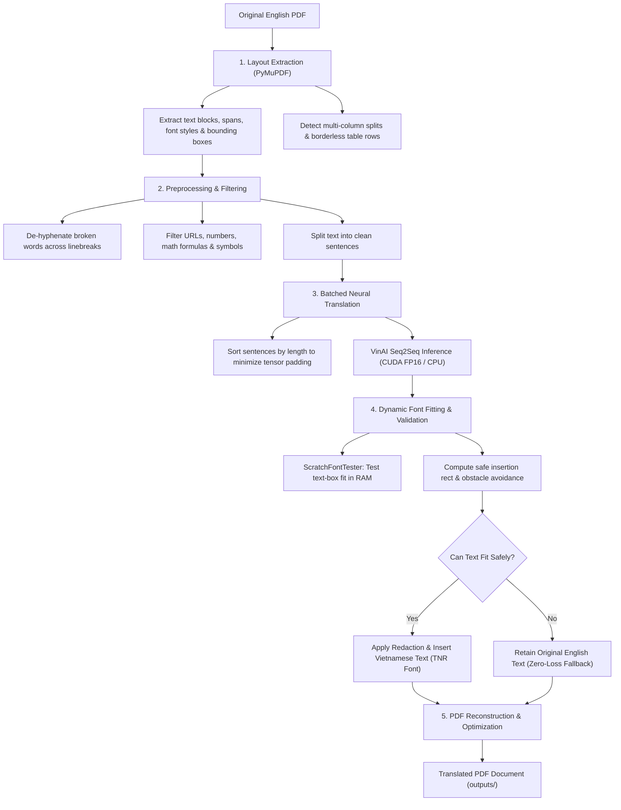

# DocuVi — Layout-Preserving AI PDF Translator (English to Vietnamese)

[](https://www.python.org/)
[](https://flask.palletsprojects.com/)
[](https://pymupdf.readthedocs.io/)
[](https://pytorch.org/)
[](https://huggingface.co/vinai/vinai-translate-en2vi)

DocuVi is an open-source, local-first Python application designed to translate English PDF documents into Vietnamese while actively preserving page layout, typography styles, tables, and graphic elements. Powered by PyMuPDF and VinAI's Seq2Seq translation model (`vinai/vinai-translate-en2vi`), DocuVi provides both an interactive single-page Web application and a headless command-line interface (CLI).

---

## Table of Contents

- [Overview](#overview)
- [Key Features](#key-features)
- [Demo & Screenshots](#demo--screenshots)
- [System Architecture](#system-architecture)
  - [Processing Pipeline](#processing-pipeline)
  - [Core Modules](#core-modules)
- [Technologies Used](#technologies-used)
- [Project Structure](#project-structure)
- [Hardware & System Requirements](#hardware--system-requirements)
- [Installation & Setup](#installation--setup)
- [Usage Guide](#usage-guide)
  - [1. Web Interface (Recommended)](#1-web-interface-recommended)
  - [2. Command-Line Interface (CLI)](#2-command-line-interface-cli)
  - [3. Python API Integration](#3-python-api-integration)
- [Experimental Benchmarks](#experimental-benchmarks)
- [Technical Limitations](#technical-limitations)
- [Testing & Quality Assurance](#testing--quality-assurance)
- [Troubleshooting](#troubleshooting)
- [Future Roadmap](#future-roadmap)
- [License & Acknowledgments](#license--acknowledgments)

---

## Overview

### The Problem
Translating technical documentation, academic papers, textbooks, and business reports in PDF format often presents severe formatting challenges:
- **Layout Breakage:** Standard tools extract text as unformatted strings, losing multi-column alignment, headers, and margins.
- **Destruction of Graphics:** Vector diagrams, charts, and raster images are frequently displaced or deleted during document re-compilation.
- **Text Overflow:** Vietnamese sentences are typically 15–30% longer than English equivalents, causing translated sentences to spill over page borders or occlude adjacent content.

### The DocuVi Solution
DocuVi tackles these problems by operating directly on the PDF layout tree:
1. It analyzes the spatial coordinates and bounding boxes of all text blocks, lines, and spans.
2. It detects non-translatable tokens (math formulas, page numbers, technical symbols, URLs) to preserve data integrity.
3. It performs length-sorted batch neural translation on GPU or CPU.
4. It utilizes a **Dynamic Font Fitting** engine with an in-memory scratch tester and Vietnamese Unicode Times New Roman fonts to calculate optimal font sizes and line heights.
5. It applies targeted redaction and text insertion while strictly protecting existing vector artwork and raster images.

---

## Key Features

- **Neural Machine Translation (EN $\rightarrow$ VI):** Powered by VinAI's `vinai/vinai-translate-en2vi` pre-trained Seq2Seq model with PyTorch FP16 half-precision on CUDA (and automatic CPU fallback).
- **Two Generation Modes:**
  - *Fast Mode (`num_beams=1`):* Greedy decoding for high throughput and rapid previews.
  - *Accurate Mode (`num_beams=4`):* Beam search decoding for higher translation fluency.
- **Layout & Column Decoupling:**
  - Differentiates multi-column reading flows and side-by-side data columns (`split_horizontal_lines`).
  - Separates borderless table rows to prevent accidental column-merging across tabular cells.
- **Graphic & Image Protection:**
  - Uses PyMuPDF redaction masks (`PDF_REDACT_IMAGE_NONE`, `PDF_REDACT_LINE_ART_NONE`) to ensure figures, illustrations, and line art remain untouched.
  - Obstacle detection prevents translated text boxes from expanding into nearby images or drawings.
- **Dynamic Font Fitting & Unicode Typography:**
  - Bundles genuine Times New Roman Unicode font variants (`times.ttf`, `timesbd.ttf`, `timesi.ttf`, `timesbi.ttf`).
  - Automated font scaling (down to 4.5pt for body text and 4.0pt for table cells) with line-height adjustment (down to 0.98).
- **Safety Fallback Mechanism:**
  - If a translated segment cannot fit into its allowable bounding box without clipping, DocuVi **retains the original English text** to avoid corrupting the document.
  - Automatic sentence-level fallback to original text if model generation returns an empty string.
- **Interactive Web UI (Single-Page App):**
  - Modern responsive UI with Tailwind CSS and Phosphor Icons.
  - Side-by-side synchronized PDF viewer (Original vs. Translated).
  - Background asynchronous task execution via `ThreadPoolExecutor` with real-time status polling.
  - Dark mode and light mode toggle.
  - Client-side history drawer powered by browser `localStorage`.
- **Command-Line Interface (CLI):** Headless execution support for automated workflows and script pipelines.

---

## Demo & Screenshots

> *Note: UI demonstration captures can be viewed directly by running the local Web application (`http://127.0.0.1:5000`). Screenshots and visual walkthrough assets will be updated in future releases.*

The web application provides:
1. **Drag-and-Drop Dropzone:** Fast document selection with client-side file type and 50MB size limit checks.
2. **Translation Mode Switcher:** Instant selection between *Siêu tốc (Fast / Greedy)* and *Chuẩn xác (Accurate / Beam Search)*.
3. **Live Progress Monitoring:** Real-time percentage progress bar indicating parsing, translation, and page rendering stages.
4. **Side-by-Side Dual PDF Viewer:** Split-screen iframe viewer comparing the original and translated files side-by-side.

---

## System Architecture

DocuVi is structured into two main layers:
1. **Application Layer (`app.py`, `templates/index.html`):** Handles HTTP requests, file uploads, background worker scheduling, and UI rendering.
2. **Engine Layer (`pdf_engine/`, `pdf_process.py`):** Encapsulates layout parsing, text processing, neural translation, font fitting, and PDF graphics reconstruction.

### Processing Pipeline



### Core Modules

| Module | Location | Primary Responsibility |
| :--- | :--- | :--- |
| **`app.py`** | Root | Flask web server, REST endpoints (`/api/translate-pdf`, `/api/job/<id>/status`), CLI runner, and asynchronous job dispatcher. |
| **`pdf_process.py`** | Root | High-level translation coordinator connecting extraction, translation, fitting, and file saving. |
| **`pdf_engine/config.py`** | `pdf_engine/` | Path definitions, font buffer lazy loading (`_LazyFontBuffers`), and font style detection. |
| **`pdf_engine/layout_extractor.py`** | `pdf_engine/` | Block and span analysis, horizontal line clustering (`split_horizontal_lines`), table row grouping, and reading-order sorting. |
| **`pdf_engine/text_processor.py`** | `pdf_engine/` | Unicode normalization (NFKC), smart hyphen reconstruction, decorative element filtering, and sentence boundary detection. |
| **`pdf_engine/renderer.py`** | `pdf_engine/` | `ScratchFontTester` (in-memory fit simulation) and `compute_safe_insert_rect` (obstacle-aware bounding box expansion). |
| **`pdf_engine/translator.py`** | `pdf_engine/` | Thread-safe singleton for model loading, dynamic batching, GPU/CPU management, and OOM handling. |

---

## Technologies Used

- **Language:** Python 3.10+
- **PDF Engine & Graphics:**
  - `PyMuPDF (fitz)` (>= 1.24.0): High-performance C-based engine for PDF text parsing, geometry computation, redaction, font embedding, and rendering.
- **Deep Learning & NLP:**
  - `PyTorch (torch)` (>= 2.0.0): Tensor computations, GPU FP16 execution, and CUDA memory management.
  - `Hugging Face Transformers` (>= 4.40.0): Model loading, Seq2Seq generation, and beam search decoding.
  - `SentencePiece` & `Protobuf`: Subword tokenization for VinAI models.
  - `vinai/vinai-translate-en2vi`: Pre-trained translation model fine-tuned for high-quality English-to-Vietnamese translation.
- **Backend Framework:**
  - `Flask` (>= 3.0.0) & `Werkzeug`: RESTful API, static file delivery, and application routing.
  - `concurrent.futures.ThreadPoolExecutor`: Asynchronous worker queue for background PDF processing.
- **Frontend Technologies:**
  - HTML5 & Modern Vanilla JavaScript (ES6+).
  - `Tailwind CSS` (via CDN): Utility-first CSS framework with dark mode support.
  - `Phosphor Icons` (via CDN): Clean icon system.
  - Browser `localStorage`: Persistent client-side translation history without database overhead.

---

## Project Structure

```text
DocuVi/
├── Font/                           # Embedded Unicode Times New Roman fonts
│   ├── times.ttf                   # Regular style
│   ├── timesbd.ttf                 # Bold style
│   ├── timesbi.ttf                 # Bold-Italic style
│   └── timesi.ttf                  # Italic style
├── pdf_engine/                     # Core PDF processing and NLP package
│   ├── __init__.py                 # Public package interface exports
│   ├── config.py                   # Font configurations & lazy buffer loading
│   ├── layout_extractor.py         # Layout parsing, column detection, table handling
│   ├── renderer.py                 # Virtual font tester & safe bounding box engine
│   ├── text_processor.py           # Text normalization, de-hyphenation, sentence split
│   └── translator.py               # VinAI model loader & batched GPU/CPU inference
├── templates/
│   └── index.html                  # Responsive single-page web interface
├── uploads/                        # Temporary input storage (.gitkeep tracked)
├── outputs/                        # Generated output PDF storage (.gitkeep tracked)
├── app.py                          # Main entry point: Flask Server & CLI Runner
├── pdf_process.py                  # End-to-end PDF translation pipeline
├── requirements.txt                # Python package dependencies
├── test_suite.py                   # Automated 15-case regression test suite
├── .gitignore                      # Git exclusion rules
└── README.md                       # Project documentation
```

---

## Hardware & System Requirements

### Recommended Hardware (GPU Mode)
- **GPU:** NVIDIA GPU with CUDA compute capability, $\ge$ 4 GB VRAM (e.g., RTX 3050 / RTX 3060 or higher).
- **RAM:** $\ge$ 8 GB system memory.
- **Storage:** $\ge$ 3 GB free disk space (to store PyTorch libraries and cached Hugging Face model weights).

### Minimum Hardware (CPU Mode)
- **CPU:** 64-bit multi-core processor (Intel Core i5/i7 or AMD Ryzen).
- **RAM:** $\ge$ 8 GB system memory.
- *Note:* The system automatically detects CUDA availability. If no compatible GPU is found, DocuVi automatically runs on the CPU. CPU inference is fully functional but significantly slower than GPU execution.

### Software Requirements
- **OS:** Windows 10/11 (64-bit), Ubuntu 20.04+ / Debian, or macOS.
- **Python:** Python 3.10, 3.11, or 3.12.

---

## Installation & Setup

### 1. Clone the Repository
```bash
git clone https://github.com/<your-username>/DocuVi.git
cd DocuVi
```

### 2. Create and Activate Virtual Environment

**On Windows (PowerShell):**
```powershell
python -m venv .venv
.\.venv\Scripts\Activate.ps1
```

**On Linux / macOS:**
```bash
python3 -m venv .venv
source .venv/bin/activate
```

### 3. Install Dependencies
```bash
pip install --upgrade pip
pip install -r requirements.txt
```

> [!TIP]
> **Enabling NVIDIA GPU Acceleration:**  
> To leverage GPU acceleration on Windows or Linux, ensure you have the appropriate CUDA-enabled PyTorch build matching your NVIDIA driver. For example, for CUDA 12.1:
> ```bash
> pip install torch --index-url https://download.pytorch.org/whl/cu121
> ```

### 4. AI Model Initialization
No manual model download is necessary. On the first translation request, DocuVi will automatically download `vinai/vinai-translate-en2vi` (~1.2 GB) from the Hugging Face Hub and cache it in your local Hugging Face cache directory (`~/.cache/huggingface/hub/`).

---

## Usage Guide

### 1. Web Interface (Recommended)

Start the local Flask development server:
```bash
python app.py
```

Once started, open your web browser and navigate to:
```
http://127.0.0.1:5000
```

1. **Upload:** Drag and drop an English `.pdf` file into the upload zone or click to select a file.
2. **Configure:** Choose your translation mode:
   - **Siêu tốc (Fast):** Greedy decoding (`num_beams=1`), ideal for long documents or fast reading.
   - **Chuẩn xác (Accurate):** Beam search (`num_beams=4`), recommended for dense technical articles.
3. **Translate:** Click **"Bắt đầu dịch ngay"**.
4. **Inspect & Download:** When processing completes, inspect the document in the side-by-side interactive viewer or download the resulting PDF.

---

### 2. Command-Line Interface (CLI)

DocuVi includes direct CLI support for headless processing and batch workflows:

```bash
# Translate a file using default settings (Greedy search, num_beams=1)
python app.py path/to/document.pdf

# Example on a sample file
python app.py uploads/test1.pdf
```

The translated document will be automatically saved to `outputs/translated_<original_filename>.pdf`.

---

### 3. Python API Integration

You can integrate DocuVi directly into custom Python scripts or pipelines:

```python
from pdf_process import translate_pdf

# Translate an English PDF document to Vietnamese
input_file = "sample_document.pdf"
output_file = "translated_document.pdf"

# Run translation with beam search
translate_pdf(
    input_path=input_file,
    output_path=output_file,
    batch_size=32,
    num_beams=4
)

print(f"Translation saved to {output_file}")
```

---

## Experimental Benchmarks

The following benchmark metrics were collected on an actual test environment:
- **Test Hardware:** Intel Core 12th Gen, 12 GB RAM, NVIDIA GeForce RTX 3050 Laptop GPU (6 GB VRAM, CUDA FP16), Windows 11.
- **Dataset:** `uploads/test1.pdf` (Medical paper on ADHD, **9 pages**, **302 extracted sentences**).

| Performance Metric | Fast Mode (`num_beams=1`) | Accurate Mode (`num_beams=4`) | Technical Context |
| :--- | :---: | :---: | :--- |
| **Model Load Time (Initial)** | ~8.14 s | ~8.14 s | Model weights loaded once into VRAM (lazy singleton) |
| **Total Pipeline Processing Time** | **5.62 s** | **~28.5 s** | Full end-to-end (layout, batch GPU inference, PDF rendering) |
| **Average Processing Speed per Page** | **~0.62 s / page** | **~3.16 s / page** | 9-page multi-column document |
| **Average Inference Time per Sentence** | **~0.019 s / sentence** | **~0.094 s / sentence** | Length-sorted dynamic GPU batches (batch size = 32) |

*Note: Actual processing times vary depending on hardware configuration, page count, text density, and graphic complexity.*

---

## Technical Limitations

To maintain realistic expectations, please consider the following known boundaries:
1. **Scanned / Image-Only PDFs:** DocuVi operates on existing vector text layers. Pure image scans lacking an embedded OCR text layer cannot be parsed (the system validates this and returns a clear descriptive message).
2. **Vietnamese Text Expansion:** Translated Vietnamese sentences are typically longer than English originals. In extremely tight layouts with no whitespace margins, the font scaler shrinks text down to safety minimums (4.5pt for text, 4.0pt for table cells). If fitting remains impossible, DocuVi **intentionally retains the original English text** to avoid page corruption.
3. **Complex Tables & Formulas:** Plain tables and column-separated numerical data are decoupled; however, nested tables with irregular row-spans or inline scientific notation ($LaTeX$ expressions) may experience minor layout shifts.
4. **Single-Worker Execution:** The backend Flask server processes jobs sequentially with `ThreadPoolExecutor(max_workers=1)` to prevent concurrent GPU VRAM contention on consumer GPUs.

---

## Testing & Quality Assurance

DocuVi includes a comprehensive, automated test suite implemented in [test_suite.py](file:///f:/project/test_suite.py). It covers 15 critical unit and regression test cases:

```bash
# Run the complete test suite
python test_suite.py
```

### Verified Test Cases:
1. `test_case_1_short_valid_pdf`: Short valid PDF with 1 paragraph.
2. `test_case_2_multipage_multipara_pdf`: Multi-page, multi-paragraph document translation.
3. `test_case_3_heading_body_bold_italic`: Style retention (Headings, Body, Bold, Italic).
4. `test_case_4_two_columns_layout`: Multi-column spatial isolation without column invasion.
5. `test_case_5_overflow_long_paragraph`: Dynamic font sizing under text expansion.
6. `test_case_6_image_only_or_scanned_pdf`: Graceful rejection of PDFs lacking a text layer.
7. `test_case_7_corrupt_or_non_pdf_upload`: Validation rejecting corrupt, non-PDF, or header-spoofed files.
8. `test_case_8_model_empty_or_error_fallback`: Automatic fallback retaining original text on empty model returns.
9. `test_case_9_text_does_not_fit_preserves_original`: Preservation of original text when text cannot fit safely.
10. `test_case_10_missing_font_fallback`: Font buffer fallback mechanism when specific variants are absent.
11. `test_case_11_job_failure_reporting`: Path sanitization preventing internal server path leakage in error responses.
12. `test_case_12_output_reopen_and_content_verification`: Verification that output PDFs reopen cleanly in PyMuPDF with valid UTF-8 Vietnamese characters.
13. `test_case_13_tab_space_formatting_and_short_titles`: Preservation of tabs, whitespace, and decorative string boundaries.
14. `test_case_14_borderless_table_row_preservation`: Column decoupling in borderless numerical tables.
15. `test_case_15_tiny_bbox_retention_regression`: Content retention in microscopic bounding boxes where insertion would fail.

---

## Troubleshooting

### 1. CUDA Out of Memory (OOM) Error
- **Symptom:** PyTorch raises `torch.cuda.OutOfMemoryError` during model load or generation.
- **Solution:** DocuVi automatically attempts fallback to CPU execution if GPU VRAM is exhausted. To minimize VRAM usage, close other GPU-intensive applications or reduce batch size in `pdf_process.py`.

### 2. Slow Translation on CPU
- **Symptom:** Document translation takes noticeably longer.
- **Solution:** Verify if PyTorch is utilizing CUDA by visiting `/api/system-status` in the Web UI. If it displays `CPU Active`, reinstall PyTorch with CUDA support from [pytorch.org](https://pytorch.org).

### 3. Missing Font Warning
- **Symptom:** Warning message in console: `Không đọc được font...`
- **Solution:** Ensure the `Font/` directory contains `times.ttf`, `timesbd.ttf`, `timesi.ttf`, and `timesbi.ttf`. If missing, DocuVi will attempt to locate matching fonts in system directories (`C:/Windows/Fonts` or `/usr/share/fonts/`).

### 4. Upload Rejected (413 Payload Too Large)
- **Symptom:** HTTP error 413 when uploading large documents.
- **Solution:** Files larger than 50MB are rejected by default to protect server memory. Optimize or compress your PDF before uploading.

---

## Future Roadmap

- [ ] **OCR Engine Integration:** Incorporate Tesseract or PaddleOCR to support scanned PDFs and flattened image documents.
- [ ] **Bidirectional Translation:** Add support for Vietnamese-to-English translation.
- [ ] **Bilingual Parallel Export:** Provide side-by-side or paragraph-interleaved bilingual output options.
- [ ] **Editable Format Export:** Add capability to export translated documents to `.docx` format.
- [ ] **Docker Containerization:** Provide official `Dockerfile` and `docker-compose.yml` for zero-configuration container deployment.

---

## License & Acknowledgments

### License
This project currently does not have an explicit open-source license assigned. All rights are reserved by the project authors pending license finalization.

### Acknowledgments
- **[VinAI Research](https://www.vinai.io/):** For training and publishing the `vinai-translate-en2vi` model.
- **[Artifex Software](https://pymupdf.readthedocs.io/):** For the fast and versatile PyMuPDF engine.
- **[Hugging Face](https://huggingface.co/):** For the Transformers model hub and runtime tools.
